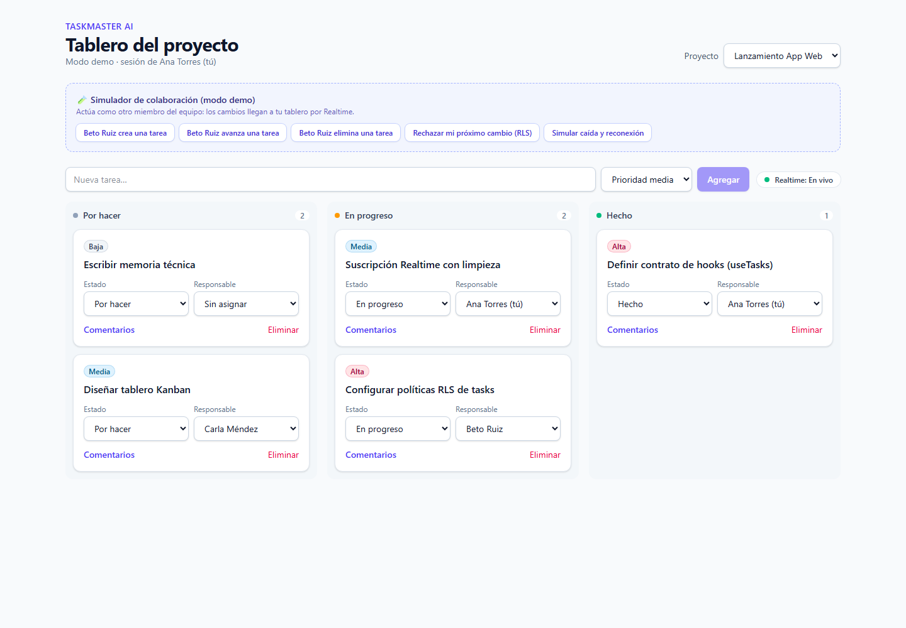
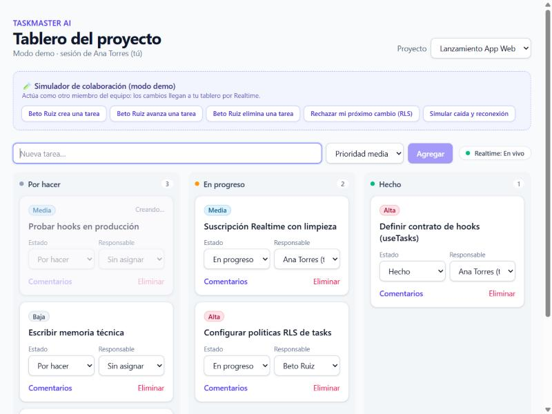
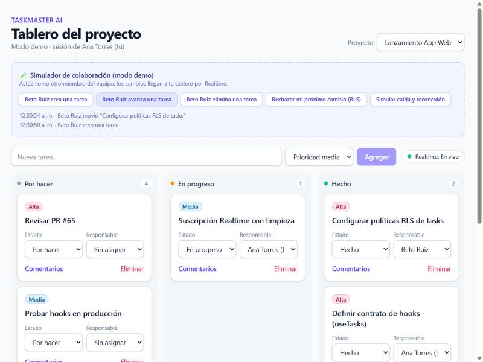
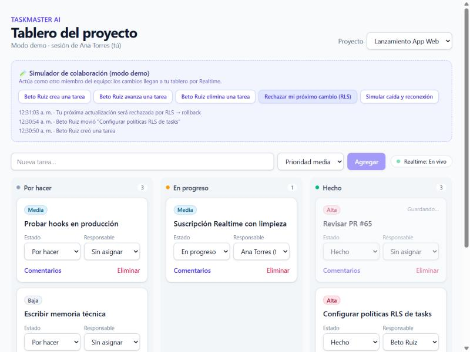
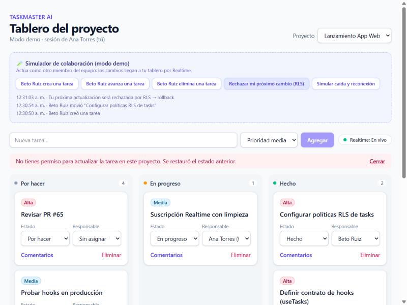
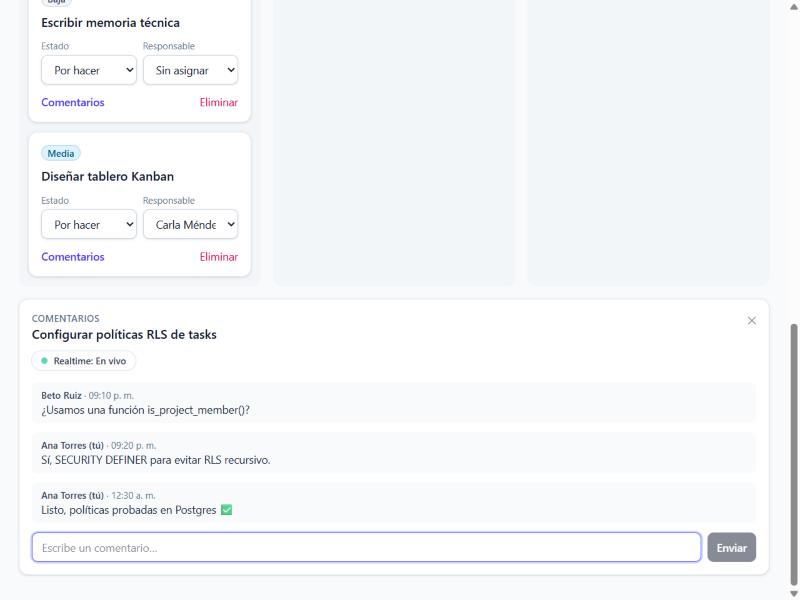

# TaskMaster AI · Arquitectura de Persistencia con Custom Hooks

Proyecto integrador: capa de datos de **TaskMaster AI** (gestión de proyectos colaborativos) refactorizada con **custom hooks** sobre `supabase-js`. Incluye fetching filtrado por proyecto, mutaciones **optimistas con rollback**, sincronización en **tiempo real** (`postgres_changes`) y **limpieza de canales** para evitar fugas de memoria.



## 📦 Entregables

| Entregable | Archivo |
|---|---|
| **Custom hook principal** (fetching + mutaciones + suscripción) | [`src/hooks/useTasks.ts`](src/hooks/useTasks.ts) |
| Hook genérico de Realtime con cleanup | [`src/hooks/useRealtimeSubscription.ts`](src/hooks/useRealtimeSubscription.ts) |
| Hooks de las otras entidades | [`useComments.ts`](src/hooks/useComments.ts) · [`useProfiles.ts`](src/hooks/useProfiles.ts) · [`useProjects.ts`](src/hooks/useProjects.ts) |
| **Ejemplo de consumo en un componente** | [`src/components/TaskBoard.tsx`](src/components/TaskBoard.tsx) |
| **Memoria técnica** | [`docs/MEMORIA_TECNICA.md`](docs/MEMORIA_TECNICA.md) |
| Tests de los hooks (14) | [`src/hooks/useTasks.test.tsx`](src/hooks/useTasks.test.tsx) · [resultado](docs/test-log.txt) |
| Esquema + políticas RLS (validado en PostgreSQL) | [`supabase/migrations/`](supabase/migrations) · [prueba RLS](supabase/tests/rls_test.sql) · [resultado](docs/rls-test-log.txt) |

## 🏗️ Arquitectura

```
Componentes (UI pura)            TaskBoard · TaskCard · CommentsPanel
        │  solo estado + funciones
        ▼
Hooks por entidad                useTasks(projectId) · useComments(taskId) · useProfiles() · useProjects()
        │                          └─ reducer puro: optimista → confirmar / rollback, eventos remotos
        ▼
Hook genérico de Realtime        useRealtimeSubscription → channel().on('postgres_changes').subscribe()
        │                          cleanup: supabase.removeChannel(channel)
        ▼
Cliente inyectado                SupabaseProvider + useSupabase()
                                   ├─ real: createClient(anon key)  → RLS en Postgres
                                   └─ demo/tests: cliente en memoria con la misma API
```

## Ejemplo de uso

```tsx
function TaskBoard({ projectId }: { projectId: string }) {
  const { tasks, isLoading, error, mutationError, pendingIds, realtimeStatus,
          createTask, updateTask, deleteTask, retry } = useTasks(projectId)

  if (error) return <ErrorState message={error} onRetry={retry} />
  if (isLoading) return <Skeleton />

  return (
    <>
      <RealtimeBadge status={realtimeStatus} />
      <NewTaskForm onCreate={createTask} />
      {mutationError && <Alert>{mutationError}</Alert>}
      {tasks.map((task) => (
        <TaskCard
          key={task.id}
          task={task}
          isPending={pendingIds.has(task.id)}
          onUpdate={(id, patch) => updateTask(id, patch)}   // optimista + rollback
          onDelete={(id) => deleteTask(id)}
        />
      ))}
    </>
  )
}
```

### API de `useTasks(projectId)`

| Retorno | Descripción |
|---|---|
| `tasks` | Tareas del proyecto (más recientes primero), nunca mezcla proyectos |
| `isLoading` / `error` / `retry()` | Estado de la carga inicial |
| `createTask(input)` | Insert optimista (id `temp-…` → id real). Devuelve la `Task` o `null` |
| `updateTask(id, patch)` | Update optimista con rollback. Devuelve `boolean` |
| `deleteTask(id)` | Delete optimista; detecta bloqueo de RLS (0 filas) y revierte |
| `pendingIds` | Ids con mutación en curso (para spinners/opacidad) |
| `mutationError` / `clearMutationError()` | Último error de mutación, en lenguaje claro |
| `realtimeStatus` | `connecting` · `subscribed` · `error` · `closed` |

## ✅ Verificación

```bash
npm test        # 14 tests: optimismo, rollback, realtime, orden de eventos, reconexión y limpieza de canales
npm run build   # tsc estricto + build
npm run lint    # oxlint
```

- Los tests usan un cliente en memoria que imita supabase-js, incluidos los eventos `postgres_changes`. Una **prueba de mutación** lo confirma: al quitar `removeChannel` o el control por `updated_at`, fallan 4 tests.
- Las políticas RLS se probaron en **PostgreSQL 16** ([`supabase/tests/rls_test.sql`](supabase/tests/rls_test.sql)): un usuario solo lee, crea, edita y borra tareas de proyectos donde es miembro (7/7 OK).

## ▶️ Ejecutar

```bash
npm install
npm run dev
```

- **Sin `.env`**: modo demo con un cliente en memoria y un **simulador de colaboración** (botones para que "Beto" cree, avance o elimine tareas, forzar un rechazo de RLS o simular una reconexión).
- **Con Supabase real**: aplica la migración (`npx supabase db push` o el SQL Editor) y copia `.env.example` a `.env`.

## 📸 Capturas

| Creación optimista ("Creando…") | Cambios de otro usuario por Realtime |
|---|---|
|  |  |

| Actualización optimista ("Guardando…") | Rollback por RLS | Comentarios en tiempo real |
|---|---|---|
|  |  |  |
